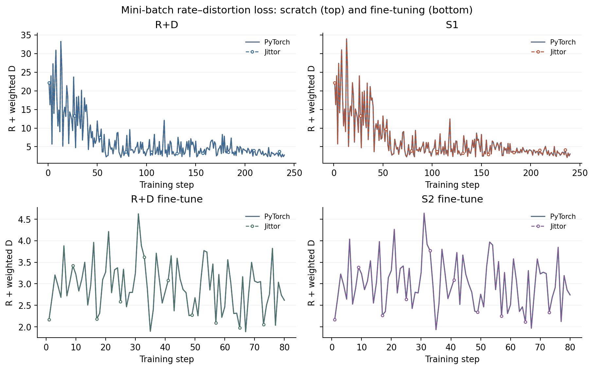
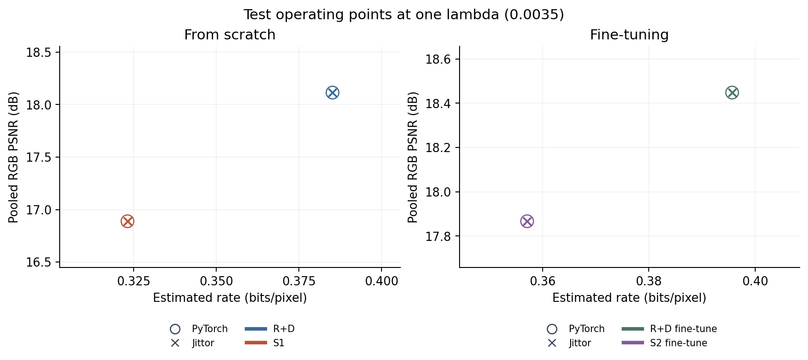
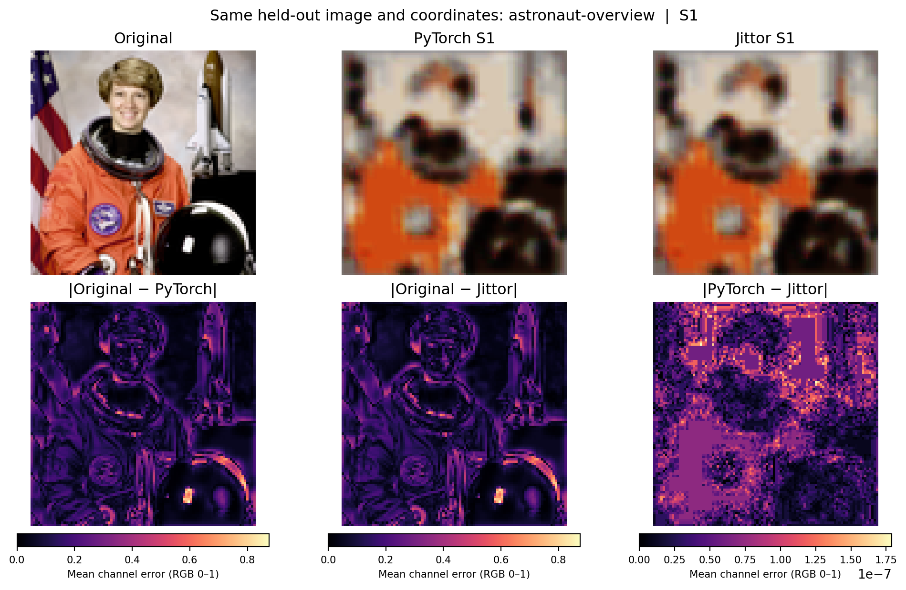

# Balanced Rate-Distortion Optimization · Jittor 复现

Yichi Zhang、Zhihao Duan、Yuning Huang、Fengqing Zhu. *Balanced Rate-Distortion Optimization in Learned Image Compression*. CVPR 2025, pp. 2428–2438. DOI 10.1109/CVPR52734.2025.00232。[CVF 论文](https://openaccess.thecvf.com/content/CVPR2025/html/Zhang_Balanced_Rate-Distortion_Optimization_in_Learned_Image_Compression_CVPR_2025_paper.html) · [作者 PyTorch 仓库](https://gitlab.com/viper-purdue/balanced-rd)

**完整 M&S 主干完成了 8 步 Jittor / PyTorch 同批次 S2 微调。** 两端训练的权重经同一 rANS 编码器实测，在 12 个留出视图上均为 **0.23698 bpp**，平均 PSNR 差 **0.0000052 dB**。下文提供这一结果的逐图字节数，也提供 S1、S2 和两组标准训练的完整轻量实验。[全尺寸真实码流记录](results/full_jittor_bitstreams.json)

## 复现问题

保持编码器和训练数据相同，分别用标准率失真目标、论文的轨迹优化（S1）和二次规划（S2）更新网络，观察每个方法如何分配码率和失真的梯度，以及它如何改变重建质量。Jittor 端独立执行卷积、自动微分、两个目标的梯度组合、logit 更新和网络 Adam 更新。PyTorch 端独立执行网络计算，两端交换 NumPy 权重与输入。

- 码率项 `R` 为量化符号的负对数概率和除以原图像素数，以 bits/pixel 为单位。失真项 `D = λ × 255² × MSE`，输入颜色范围为 [0,1]。训练日志中的 `rd` 一律记录 `R+D`，可直接比较不同更新方法。
- **S1 从头训练**。在同一批次和同一量化噪声上比较参数更新前后的两项对数损失。下降较慢的目标影响下次更新方向。复现采用作者公开 ELIC 训练代码的 loss+1、logit Adam、学习率 0.025 和衰减 0.003。正文实验部分写的是 0.001。S1 的 `rate_coeff` 和 `dist_coeff` 是归一化后乘在原始梯度上的系数。[作者训练脚本固定版本](https://gitlab.com/viper-purdue/balanced-rd/-/blob/e6dacff161acbd42c5a705745bace48f1fec8dfb/train_balanced.py)
- **S2 从相同的标准训练检查点微调**。先算两项对数梯度的 2×2 Gram 矩阵，再求约束下的解析权重，按原文式 26 做 softmax，最后转换为对原始梯度的系数。相同梯度的退化情形用对称解。额外的标准微调组提供相同步数、同学习率的比较。[论文 §3.2.2](https://openaccess.thecvf.com/content/CVPR2025/papers/Zhang_Balanced_Rate-Distortion_Optimization_in_Learned_Image_Compression_CVPR_2025_paper.pdf)

## 本机实验

主实验在 12 个留出视图上得到以下实测值。表中训练耗时为预热后的每步中位数，BPP 列均为熵模型估计值。

| 方法 | Jittor bpp | PyTorch bpp | Jittor PSNR (dB) | PyTorch PSNR (dB) | Jittor / Torch 训练 (ms/步) |
|---|---:|---:|---:|---:|---:|
| 标准训练 | 0.38518 | 0.38518 | 18.11380 | 18.11380 | 1.32 / 1.92 |
| S1 从头训练 | 0.32316 | 0.32316 | 16.88853 | 16.88853 | 1.81 / 2.56 |
| 标准微调 | 0.39566 | 0.39566 | 18.44785 | 18.44785 | 1.36 / 1.86 |
| S2 微调 | 0.35710 | 0.35710 | 17.86666 | 17.86666 | 1.69 / 3.57 |

四种方法中，独立训练后的跨框架最大差为 4.53×10⁻⁸ bpp、3.76×10⁻⁷ dB。S2 相比相同步数的标准微调降低估计码率 9.75%，同时 PSNR 下降 0.58 dB。S1 的码率也随失真增大而降低。在当前单个 λ 和短程训练下，两种方法的 R+D 均高于各自对照组。码率下降与重建质量的变化需要一起解释。[八组对齐数据和耗时](results/figures/alignment.csv) · [各方法对照分析](results/figures/summary.md)







## 数据、训练与测试

从 scikit-image 0.25.2 自带样例照片构造小数据集。训练照片为 camera、coffee、chelsea、brick、grass、hubble_deep_field，每张抽取 32 个视图，共 192 个 32×32 RGB 样本。测试照片为 astronaut、rocket、gravel，各取一个缩略图和三个固定局部视图，共 12 个 96×96 样本。先按原照片分组，随后裁切。原文件与生成数组的 SHA-256 可在 [manifest](data/manifest.json) 核对。camera、coffee、chelsea 及三种纹理图片为 CC0，astronaut 与 Hubble 照片来源 NASA，rocket 来源 SpaceX。图片随原来源条款使用。[图像来源说明](https://scikit-image.org/docs/stable/api/skimage.data.html)

两端的网络和 Adam 状态使用 FP32，逐像素损失的求和或均值使用 FP64，缓解不同后端的累积误差。

主实验使用两级步长 2 的卷积分析变换（3→8→4 通道），最近邻放大与卷积合成变换，以及按通道学习尺度的 logistic 熵模型。训练采用均匀量化噪声，测试采用取整。小模型输出估计 bpp。测试 PSNR 在 RGB [0,1] 全部测试像素的整体 MSE 上计算。每个框架使用同一套初始化、样本顺序和量化噪声，日志保存调度哈希。两种从头训练方法各 240 步，batch=4，网络学习率 0.003。两种微调方法均从该框架的标准训练第 240 步开始，重置 Adam，再以 0.0006 学习率训练 80 步。四组均取论文的 λ=0.0035。

两端网络优化器均采用标准 Adam，未启用作者 ELIC 训练脚本的 cautious 更新、梯度裁剪和 EMA。原论文在 COCO 2017 上使用多个模型和六个 λ，比较 Kodak、Tecnick 等基准上的率失真曲线。本实验的数据、训练轮数与编码器规模支持核对实现和观察单工作点的取舍。论文报告的约 2% BD-rate 改善需要多码率完整曲线验证。

## 环境与复跑

实测 Intel Core i9-14900HX CPU。PyTorch 跑在 Windows，Jittor 跑在 WSL2/Linux。本机 Jittor 1.3.11.0 使用 Python 3.10.10、NumPy 1.26.4、GCC 15.2、oneDNN。Windows 对照使用 PyTorch 2.8.0+cu128、Python 3.9.25 和 NumPy 1.23.5，实际计算设备为 CPU。主实验的吞吐记录包含各自运行环境的影响。推荐用 Python 3.10 建立独立环境，使用 Jittor 所需的 C++ 编译器。数据准备也可在另一个 Python 环境执行，再共享 `data` 目录。[Jittor 安装说明](https://github.com/Jittor/jittor)

```bash
# 在仓库根目录执行。将 ENVROOT 指向用于保存运行环境和缓存的数据盘。
export ENVROOT="$PWD/../runtime"
mkdir -p "$ENVROOT/tmp" "$ENVROOT/jittor" "$ENVROOT/cache"
export TMPDIR="$ENVROOT/tmp" JITTOR_HOME="$ENVROOT/jittor" XDG_CACHE_HOME="$ENVROOT/cache"
export PIP_CACHE_DIR="$ENVROOT/cache/pip" MPLCONFIGDIR="$ENVROOT/cache/matplotlib" TORCH_HOME="$ENVROOT/cache/torch"
export OMP_NUM_THREADS=1 OPENBLAS_NUM_THREADS=1 MKL_NUM_THREADS=1
python3.10 -m venv "$ENVROOT/venv"
source "$ENVROOT/venv/bin/activate"
python -m pip install -r requirements-data.txt
python -m pip install torch==2.8.0 --index-url https://download.pytorch.org/whl/cpu
python -m pip install jittor==1.3.11.0
python prepare_data.py
# 已有该版本样例图片时可指定 --images /path/to/skimage/data
for backend in torch jittor; do
  for method in vanilla s1 vanilla-ft s2; do
    python train.py --framework "$backend" --method "$method" || exit 1
  done
done
python train.py --framework jittor --method s2 --test-only
python report.py
```

每组文件在 `results/<framework>/<method>/`。[`train.csv`](results/jittor/s1/train.csv) 保存逐步 R、D、权重和耗时。[`metrics.json`](results/jittor/s1/metrics.json) 保存步数、环境版本、估计 bpp、PSNR、推理时间和训练时间。`test.csv` 给出 12 个视图各自的 MSE 和 PSNR。`checkpoint.npz` 可直接运行测试，`recon.npz` 保存完整重建阵列。训练计时取去除前 10 步后的中位数，推理计时为预热后同一批次重复 5 次的中位数除以批量，包含回传主机，不含文件读取。

在本机 F 盘项目的 PowerShell 中执行 `./run_local.ps1 -Action test -Method s2` 即可用保存的检查点演示 Jittor 测试。脚本调用相邻 `runtime/python-memory.sh`，将 F 盘环境快照在 WSL 内存中展开。Jittor 在这台机器的 GCC 15.2 下需要 `cc_flags="-includecstdint -Wno-template-body"`，启动器已设置这些兼容参数。

### 对照作者原始 S1 函数

原始脚本下载到项目外部并校验 SHA-256。验证脚本调用其两个 S1 函数，同时控制批次、初始权重、量化噪声及网络 Adam。独立数值检查还对 S2 使用矩阵解直接核对两任务的梯度系数。

```bash
curl -fsSL https://gitlab.com/viper-purdue/balanced-rd/-/raw/e6dacff161acbd42c5a705745bace48f1fec8dfb/train_balanced.py -o "$ENVROOT/official_train_balanced.py"
python validate_balancer.py controller
python validate_balancer.py torch --upstream "$ENVROOT/official_train_balanced.py"
python validate_balancer.py jittor
python validate_balancer.py compare
python parity.py torch
python parity.py jittor
python parity.py compare
```

[独立控制器数值记录](results/controller_check.txt) · [真实作者函数单步对照](results/one_step/comparison.json) · [同一检查点三种更新的误差](results/parity/alignment.json)

### 全尺寸骨干附加实验

额外使用 CompressAI 模型库的预训练 M&S Hyperprior（质量 1，N=128，M=192，7,028,003 个参数）。架构对应论文表 1，检查点来源为 CompressAI 模型库。Jittor 原生实现 GDN/IGDN、超先验和条件概率。三张留出图逐层检查 28 个输出，最终 RGB 最大绝对误差 2.68×10⁻⁶。同一真实裁块的一步 S2 更新覆盖 7,027,619 个率失真参数，另 384 个辅助 quantile 保持预训练值。更新后两框架估计 bpp 相差 3.58×10⁻⁷。[模型库](https://interdigitalinc.github.io/CompressAI/zoo.html#mbt2018-mean) · [上游许可](LICENSE-CompressAI.txt) · [逐层记录](results/full_jittor.json) · [全参数单步记录](results/full_step_jittor.json)

PyTorch/CompressAI 还实际编码并解码 12 个视图。下表按两路 rANS 载荷字节计算 bpp，分母为补边前的原图像素数，不含文件头。PSNR 按视图求平均。S2 和标准微调均为相同起点、8 步、λ=0.0018。S2 相比等步标准微调多用 0.00058 bpp，PSNR 高 0.061 dB。两组微调在此留出集上均未超过原始检查点。[逐图真实字节数与日志](results/full_model.json)

| PyTorch 全模型 | 实际 bpp | 平均 PSNR (dB) |
|---|---:|---:|
| 预训练 | 0.22627 | 26.791 |
| 标准微调 | 0.23640 | 26.613 |
| S2 微调 | 0.23698 | 26.674 |

对完整 M&S 的 S2 再复放相同的 8 个批次和逐元素量化噪声，Jittor 与 PyTorch 的训练码率最大差为 1.18×10⁻⁶ bpp，梯度系数最大差为 1.12×10⁻⁵。两套微调参数分别交给同一 CompressAI rANS 编码器，12 个视图的平均真实码率均为 **0.23697917 bpp**，平均 PSNR 分别为 **26.67419566 dB** 与 **26.67419048 dB**。Jittor 原生前向与码流解码像素的最大绝对偏差为 2.21×10⁻⁶。全模型原生训练中逐步验证梯度、参数和两阶矩有限。为兼容本机 CPU 对极小正数的平方根实现，在开方前对 Adam 偏差校正后的二阶矩设 10⁻³⁴ 下界，这个量级对 ε=10⁻⁸ 的 FP32 分母舍入结果无影响。[逐步训练与逐图估计码率](results/full_jittor_finetune.json) · [真实码流与通过条件](results/full_jittor_bitstreams.json)

在带 PyTorch 的环境中安装 `compressai==1.2.4` 与相容的 `torchvision`。运行以下代码生成对照输入。导出的权重、逐层张量和缓存保存在项目外的运行目录。

```bash
python validate_full_model.py --bridge "$ENVROOT/full-model-reference" --output "$ENVROOT/full-model-reference/torch-replay.json"
python export_full_reference.py --bridge "$ENVROOT/full-model-reference"
python validate_full_jittor.py --bridge "$ENVROOT/full-model-reference"
python validate_full_step.py --backend torch --bridge "$ENVROOT/full-model-reference"
python validate_full_step.py --backend jittor --bridge "$ENVROOT/full-model-reference"
python replay_full.py --stage train --bridge "$ENVROOT/full-model-reference"       # Jittor
python replay_full.py --stage bitstreams --bridge "$ENVROOT/full-model-reference"  # PyTorch/CompressAI rANS
```

## 选题记录

按 2026-11-23 核查，本论文与播种期的学习式图像压缩主题一致，正式发表于 2025 年 6 月。检索训练营公开列表，并对论文全名、Balanced-RD、arXiv 2502.20161 与 Jittor 组合检索，未发现已有公开 Jittor 复现。公开索引覆盖范围及列表更新时间限制了查重结论。[训练营公开列表](https://github.com/GrokCV/Jittor-Sprouts) · [论文](https://arxiv.org/abs/2502.20161)

